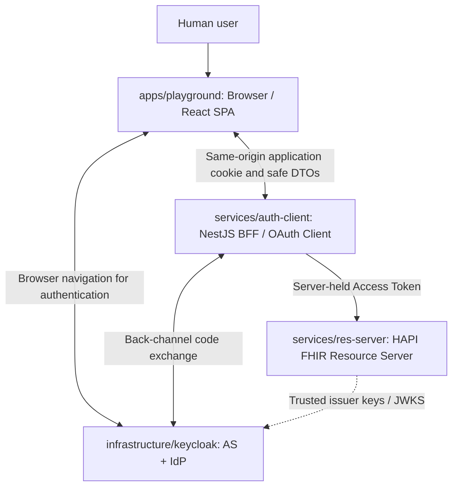

# Architecture — Context & Trust Boundaries

**Status:** DRAFT FOR ARCHITECTURE REVIEW · **Version:** 0.2

**Readiness reconciliation:** 2026-11-11, change `001-oidc-pkce`, tasks 1.1–1.3 only

This document aligns with the [integration design](../../openspec/changes/001-oidc-pkce/design.md) and its two capability specifications. The proposed OAuth integration remains **DRAFT — NOT IMPLEMENTATION-AUTHORIZED**. The [readiness review and consolidated approval summary](../../openspec/changes/001-oidc-pkce/readiness-review.md) records the review evidence and pending owner decisions.

## Components and current implementation boundary

| Component                 | Current repository state                                                                                                   | Proposed local integration responsibility                                                                                                     |
| ------------------------- | -------------------------------------------------------------------------------------------------------------------------- | --------------------------------------------------------------------------------------------------------------------------------------------- |
| `apps/playground`         | React SPA / Mission Control; fixture-only OAuth preview and conceptual ePA workspace                                       | Preserve the Catalog/Workspace design; add mission-owned browser navigation, session/run restoration and safe event projection after approval |
| `services/auth-client`    | Existing NestJS confidential OAuth/OIDC client; ePA PAR header operation, browser login/callback and session demonstration | Reuse as the BFF; add the isolated standard mission routes, local session/logout, fixed resource access and owned event API                   |
| `infrastructure/keycloak` | Existing Keycloak realm and ePA client with required PAR and S256                                                          | Same deployment fulfills Authorization Server and IdP roles; add a separate standard client without changing ePA policy                       |
| `services/res-server`     | Canonical HAPI FHIR Git submodule; inbound security is not implemented/verified                                            | Independently validate bearer credentials and permission for one synthetic FHIR read; deny undeclared data operations                         |

No new BFF, Resource Server, Keycloak deployment or realm is proposed. Existing dependency declarations and disabled placeholder HAPI security settings do not establish a protected API. Obsolete build/Compose paths and the duplicate HAPI gitlink are documented implementation work in groups 2–9, not repaired or accepted by this review.

## Logical architecture for the proposed first runnable mission



| Role                  | Component                             | Boundary                                                                                        |
| --------------------- | ------------------------------------- | ----------------------------------------------------------------------------------------------- |
| Resource Owner / User | Human user                            | Grants access; not the SPA                                                                      |
| User Agent / UI       | Browser hosting React Mission Control | Follows redirects and displays Keycloak login; holds no JavaScript-accessible OAuth credentials |
| OAuth/OIDC Client     | NestJS auth-client / BFF              | Confidential client, transaction owner and server-side token holder                             |
| Authorization Server  | Keycloak                              | Issues authorization codes and tokens                                                           |
| Identity Provider     | The same Keycloak deployment          | Performs authentication; a separate logical OIDC role, not another server                       |
| Resource Server       | HAPI FHIR                             | Independently validates Access Token and resource permission                                    |

IdP is not one of the four OAuth 2.0 roles. Browser redirects and direct BFF-to-provider requests are different channels.

## Separate standard and existing ePA profiles

The proposed `playground-standard` profile uses confidential Keycloak client `playground-oidc` in the existing realm. It starts Authorization Code + PKCE S256 directly, requests `openid demo.fhir.read`, and makes **no PAR call**. Standard discovery does not require PAR metadata. The resource Access Token audience is `playground-fhir`; the ID Token audience remains the OAuth client.

The existing `epa-par` profile retains its current client configuration, PAR discovery requirement, `require-par` marker and required-PAR policy. Standard configuration must not weaken or bypass that policy.

Existing implemented routes remain separate:

| Method and route                                   | Preserved ePA behavior                                                                                                                           |
| -------------------------------------------------- | ------------------------------------------------------------------------------------------------------------------------------------------------ |
| `GET /epa/authz/v1/send_authorization_request_fdv` | Header-based stateless PAR smoke operation returning a redirect; it does not establish the browser transaction needed by the callback            |
| `GET /login`                                       | Browser-bound ePA login using PAR                                                                                                                |
| `GET /callback`                                    | Correlates and consumes that browser transaction, exchanges/validates tokens, establishes the existing ePA session and returns 303 to `/session` |
| `GET /session`                                     | Existing ePA demonstration session response                                                                                                      |

Preserve existing ePA cookies, response contracts and tests. A smoke redirect or successful Keycloak authentication alone does not establish an application session; the originating browser binding and tracked callback transaction must also be valid. Mission Control's ePA entry stays conceptual, despite this separate existing backend demonstration. Comparing both flows in the UI is deferred.

## Proposed standard browser API and redirects

These routes belong to the existing auth-client and are **not implemented by this documentation work**:

| Method and route                    | Contract                                                                                                                                                                               |
| ----------------------------------- | -------------------------------------------------------------------------------------------------------------------------------------------------------------------------------------- |
| `GET /api/oauth/login`              | Normal top-level browser navigation; create a fresh run and one-time standard transaction, set browser binding, redirect to Keycloak                                                   |
| `GET /api/oauth/callback`           | Check callback shape, state, browser binding, stored profile and token validation; consume once; eligible completion returns a clean 303 to the fixed OAuth Workspace                  |
| `GET /api/oauth/session`            | Minimal auth/expiry/current-run outcome and context-bound logout anti-CSRF value; no tokens, raw identity claims or transaction secrets                                                |
| `POST /api/oauth/logout`            | Exact configured Origin and context-bound anti-CSRF checks; invalidate local authentication, cancel bound attempts, remove credentials and rotate to unauthenticated viewing ownership |
| `GET /api/oauth/resource`           | Require standard application authentication; call only the configured synthetic HAPI read using its server-held Access Token; return a bounded safe result                             |
| `GET /api/oauth/runs/:runId/events` | Require browser viewing ownership and unexpired run; return versioned allowlisted event projections                                                                                    |

The fixed return is `/missions/oauth-oidc/workspace`. Correlated success, provider denial and exchange/validation failure return there with safe server-side outcome state, without callback parameters. An uncorrelated callback grants no run access. Do not accept caller-selected clients, issuers, callback settings, upstream URLs or `returnTo` destinations.

Login and callback use the same application host and running auth-client instance. Missing/mismatched binding, unknown/expired/lost transactions, cross-profile substitution, replay and concurrent duplicate completion fail safely. A restart loses process-local context and requires a fresh login. Refresh restores via session and owned-event reads; it does not repeat protocol actions.

## Sequence (illustrative, not an observed trace)

```mermaid
sequenceDiagram
  actor U as User
  participant W as Browser / React SPA
  participant B as auth-client / OAuth Client
  participant K as Keycloak / AS + IdP
  participant R as HAPI / Resource Server
  U->>W: Start standard authentication
  W->>B: GET /api/oauth/login (top-level navigation)
  Note over B: Store one-time profile-bound transaction, state, nonce and PKCE binding
  B-->>W: Redirect to discovered authorization endpoint
  W->>K: Follow authorization redirect
  Note over K: Authentication and PKCE checks are internal, not BFF-observed
  K-->>W: Redirect to registered callback
  W->>B: GET /api/oauth/callback
  Note over B: Correlate browser and consume transaction once
  B->>K: Code exchange at discovered token endpoint (back channel)
  K-->>B: Token response
  Note over B: Validate tokens; recheck original context/attempt after async work before synchronous session commit
  B-->>W: Rotate HttpOnly cookie; 303 /missions/oauth-oidc/workspace
  W->>B: GET /api/oauth/session and owned run events
  U->>W: Read synthetic resource
  W->>B: GET /api/oauth/resource with application cookie
  B->>R: GET /fhir/Basic/playground-demo with Access Token
  Note over R: Independent bearer and permission enforcement
  R-->>B: Bounded synthetic result or denial; explicit safe decision report
  B-->>W: Safe result and BFF-observed event projection
```

This sequence explains intended behavior. It does not publish callback secrets or claim Keycloak-internal checks are directly observable.

## Session, logout and asynchronous trust boundary

The BFF selects one of the two fixed profiles server-side and binds issuer, client identity, callback URI, profile and run to each pending transaction. Exchange credentials and token checks come from that stored record, never callback input. Reuse existing cryptographic/JWT libraries and preserve one-time consumption before exchange.

OAuth credentials stay in auth-client. The standard context cookie has a different name from ePA, is HttpOnly, SameSite=Lax, scoped to `/api/oauth`, and Secure under HTTPS. The callback binding cookie is callback-scoped with the ten-minute login lifetime. Rotate the context identifier on authentication and logout; invalidate the prior identifier. Authentication expires no later than token expiry.

A valid local logout must:

1. Invalidate the active standard application session and remove server-held credential references.
2. Cancel every pending login bound to that context, including a consumed callback awaiting asynchronous exchange or validation.
3. Reject a known cancelled callback before exchange. After all asynchronous work, recheck the original context and attempt for cancellation, expiry or supersession immediately before session commit. The final check and commit are one synchronous local state transition.
4. Discard credentials from a stale completion; issue no authenticated cookie and never overwrite the replacement unauthenticated viewing context.
5. Preserve other browsers and existing ePA/PAR contexts.

Logout requires the exact configured Origin and a context-bound anti-CSRF value from the same-origin session response, supplied in a header. A cookie alone is insufficient; GET never logs out. The anti-CSRF value is not teaching evidence. Local logout does not claim Keycloak SSO logout or immediate bearer-token revocation.

Context/run viewing expires within its original fifteen-minute lifetime. Bound each collection to 1000 entries and each run to 100 events. A run ID grants no access by itself. After logout, only the replacement unauthenticated context can view its eligible non-sensitive history; history grants no resource permission and logout does not renew retention.

**Cleanup is independent of trace persistence.** Capacity may reject ordinary execution before external work, but must never prevent session invalidation, login cancellation or credential cleanup, including expiry cleanup. Event append rejection, failure or exception cannot roll cleanup back. If the logout observation cannot be stored, the session still reads signed out; show observation/trace completeness as unavailable without inventing an event, timestamp or sequence.

## Independent HAPI authorization boundary

The sole proposed exercise is `GET /fhir/Basic/playground-demo`, a synthetic nonclinical R4 Basic resource seeded through local/test setup, not anonymous writes. HAPI independently validates signature/key/algorithm, issuer, `playground-fhir` audience, expiry/not-before, token purpose and `demo.fhir.read`. BFF session cookies and ID Tokens do not authorize HAPI.

Return 401 for missing/invalid bearer credentials and 403 for valid credentials without permission or for undeclared data operations. Default-deny other FHIR reads, writes, searches, history, batch/transaction and data-bearing alternate endpoints, including MCP/CDS/test paths. Only explicitly reviewed data-free health/readiness exceptions are allowed. Acceptance must exercise direct HAPI requests as well as the BFF path.

The BFF forwards only its server-held Access Token to the single configured read, with time/size limits. It returns a small safe synthetic view or stable failure code; it is not an arbitrary proxy. A BFF 401 before an upstream request must not be shown as a HAPI denial.

## Safe event provenance

The version-1 discriminated event contract has stable `eventId`/`runId`, per-run `sequence`, actual `observedAt`/`observedBy`, closed `kind`, actor references, channel, outcome and per-kind allowlisted `evidence`. Unknown/unsafe fields, kinds or versions are rejected; no raw JSON fallback or false complete-trace claim. The [design's event contract](../../openspec/changes/001-oidc-pkce/design.md#6-define-a-versioned-safe-observation-contract) is canonical.

auth-client observes its own correlation/validation, exchange outcomes and received HAPI responses. An event for a HAPI response is `observedBy: auth-client` with the BFF observation time. A 200 response does not prove a list of internal security checks.

Only explicit, bounded reports from the configured HAPI endpoint may provide a nested `reportedBy: res-server` decision:

- `X-Playground-Decision`: `allowed` or `denied`.
- `X-Playground-Reason`: `demo-read-allowed`, `missing-token`, `invalid-token`, `insufficient-permission`, or `operation-not-allowed`.

Missing, malformed, unknown or conflicting report fields leave the reason unavailable. Do not invent a Resource Server timestamp or internal check list. Keycloak password validation, PKCE comparison and token creation remain **Explained / Not observable**. Actor-local observations use no network arrow. Fixtures retain their explicit labels and have no fabricated observer/time.

Teaching responses and routine application/proxy/resource logs exclude passwords, authorization codes, state/nonce, PKCE verifiers, tokens, client secrets, cookie values, raw callbacks/identity claim sets and entire HTTP bodies. Configure callback access logging to omit query strings; use no-store and safe referrer handling. The only existing browser persistence remains explicit locale preference.

## Frontend and hosting boundaries

The shell and protocol-flow capability remain mission-neutral under Accepted ADR-0003. Mission owns declarations, runtime adaptation and actions; protocol-flow renders neutral actors/events/selection through its existing public entries. Do not add a runtime plugin framework or put OAuth/ePA branches in generic controls. Preserve German-default/English behavior under Accepted ADR-0004, the two-card catalog, current artwork/layout and fixture mode.

UI Slice 001 is hosted in an isolated `apps/playground` package alongside the existing `epa-auth-lab` services. Repository inspection confirmed those services and infrastructure already exist. The UI does not call or alter them. This is a UI-only coexistence boundary, not approval of backend integration.

On 2026-10-19, the owner authorized static UI deployment at `auth-playground.yappai.de` and registration in Yoster. The dedicated `infrastructure/docker-compose.playground.yml` stack builds only `apps/playground`, serves its compiled assets with Nginx and joins the existing `dev-proxy` network. Traefik's watched host configuration `../infra/traefik/dynamic/epa-lab.yml` routes the hostname to `http://epa-lab-playground:80`; public HTTPS requires the hostname on the existing Cloudflare tunnel. The root `yappai.host.json` manages and monitors only this static stack. No backend, authentication provider, session or database is part of this deployment.

Future same-origin API routing uses existing Vite/Nginx configuration for **local/private** testing after approval. No broad credentialed CORS policy or new gateway is needed. Public API/auth-client/Keycloak/HAPI exposure is outside this change's implementation scope and requires separate authorization. Static-hosting permission does not grant authentication deployment permission.

## Pending acceptance

ADR-0001 and ADR-0002 remain PROPOSED. This reconciliation resolves obsolete component/route alternatives in the documentation; it does not accept those ADRs or complete task 1.4. The owner must review the consolidated UX/security/ADR summary and explicitly approve the complete change and local/private implementation before groups 2–9 start. Prior verification reports remain historical evidence.

## Reference specifications

- [OAuth 2.0](https://www.rfc-editor.org/rfc/rfc6749)
- [PKCE](https://www.rfc-editor.org/rfc/rfc7636)
- [OIDC Core](https://openid.net/specs/openid-connect-core-1_0.html)
- [OAuth Security BCP](https://www.rfc-editor.org/rfc/rfc9700)
- [PAR, used by the preserved ePA profile](https://www.rfc-editor.org/rfc/rfc9126)
