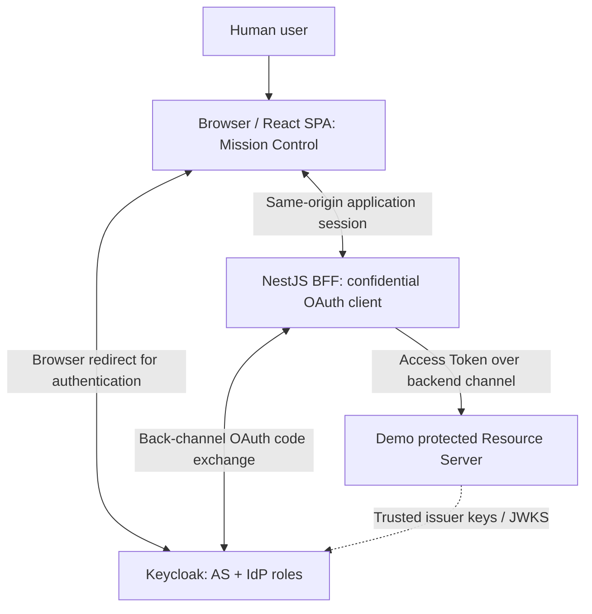

# Architecture — Context & Trust Boundaries

**Status:** DRAFT FOR ARCHITECTURE REVIEW · **Version:** 0.1

## Logical architecture for first runnable mission



**Important:** a Keycloak authorization redirect is initiated via the user agent. Keycloak is one deployment that fulfills two logical roles: **Authorization Server** and **Identity Provider**.

## Role mapping

| Role | Component | Remark |
|---|---|---|
| Resource Owner | Human user | Not the React SPA |
| User Agent | Browser hosting SPA | Follows redirects and presents Keycloak login UI |
| OAuth/OIDC Client | NestJS BFF | Confidential client and PKCE transaction owner |
| Authorization Server | Keycloak | Issues authorization codes and tokens |
| Identity Provider | Keycloak | Performs authentication (separate logical role) |
| Resource Server | Demo protected API | Independently validates Access Token and permission |

OIDC IdP is not one of the four original OAuth 2.0 roles; keep it explicit for educational accuracy.

## Sequence (illustrative; not an observed trace)

```mermaid
sequenceDiagram
  autonumber
  actor U as User
  participant W as Browser / SPA
  participant B as NestJS BFF (OAuth Client)
  box rgb(234,245,255) Keycloak
    participant A as Authorization Server
    participant I as Identity Provider
  end
  participant R as Resource Server
  U->>W: Select Start authentication
  W->>B: GET /auth/login (browser navigation)
  Note over B: Generate state and PKCE verifier / challenge; persist transaction securely
  B-->>W: HTTP redirect to Keycloak /authorize
  W->>A: GET /authorize (challenge, state, OIDC scope, ...)
  A->>I: Request authentication (logical transition)
  I-->>W: Show Keycloak login form
  U->>W: Enter credentials in Keycloak context
  W->>I: Submit authentication
  I-->>A: Authentication result (logical transition)
  A-->>W: Redirect with code and state
  W->>B: GET /auth/callback with code and state
  Note over B: Correlate browser session / validate state
  B->>A: POST /token with code + code_verifier (back channel)
  Note over A: Verify PKCE binding (internal)
  A-->>B: Token response
  Note over B: Validate OIDC response, create application session
  B-->>W: Set HttpOnly session cookie and redirect to SPA
  U->>W: Request protected demo data
  W->>B: GET /api/demo-resource with app cookie
  B->>R: GET /resource with Access Token
  Note over R: Validate signature, issuer, audience, expiry, permission
  R-->>B: Synthetic demo data or denial
  B-->>W: Result and sanitized event record
```

The explicit AS/IdP transition above is **conceptual**, not necessarily a separate HTTP request within Keycloak. Likewise, a success label cannot prove that the BFF directly observed a Keycloak-internal PKCE check.

## Core security boundaries

- The SPA interacts with the BFF using an application session cookie; no bearer token in browser JavaScript, local storage or UI evidence.
- BFF initiates Authorization Code + PKCE S256 and protects short-lived, one-time transaction material (`state`, code verifier, nonce as applicable).
- Authentication happens in the **Keycloak UI**, not in the BFF or playground SPA.
- BFF exchanges the code directly with Keycloak and validates the OIDC response with a maintained library.
- BFF holds tokens server-side, uses a hardened cookie and applies CSRF protections to state-changing endpoints.
- Resource Server independently verifies intended token audience, issuer, signature, lifetime and permission. ID Tokens are not API access credentials.
- Trace API only returns mission-safe allowlisted projections; no raw request/response bodies, URLs, secrets or credentials.
- Real and conceptual steps are never represented as the same evidence type.
- Public deployment needs an explicit separate security review (TLS, cookie settings, session store, CSRF, abuse controls, secrets, exposure of traces).

## Mission extensibility boundaries

The shell handles generic catalog/learning/timeline UI. The OAuth execution capability owns BFF-specific auth operations. Future missions can have their own backend protocol capabilities and providers; **do not hardwire Keycloak into the generic shell**.

## Open architecture decisions

UI Slice 001 is hosted in an isolated `apps/playground` package alongside the existing `epa-auth-lab` services. Repository inspection confirmed those services and infrastructure already exist. The UI does not call or alter them. This is a UI-only coexistence boundary, not approval of backend integration.

- Host the first mission in a standalone repository vs adding non-breaking modules to `epa-auth-lab`.
- Separate Resource Server process or independently authorized module with clear trust boundary for first deployment.
- Implementation library, version pins and Keycloak realm details (decide **when implementation is approved**).

## Reference specifications

- OAuth 2.0: https://www.rfc-editor.org/rfc/rfc6749
- PKCE: https://www.rfc-editor.org/rfc/rfc7636
- OIDC Core: https://openid.net/specs/openid-connect-core-1_0.html
- OAuth Security BCP: https://www.rfc-editor.org/rfc/rfc9700
- OAuth Browser-Based Apps: https://www.rfc-editor.org/rfc/rfc10017
- PAR for later change: https://www.rfc-editor.org/rfc/rfc9126
