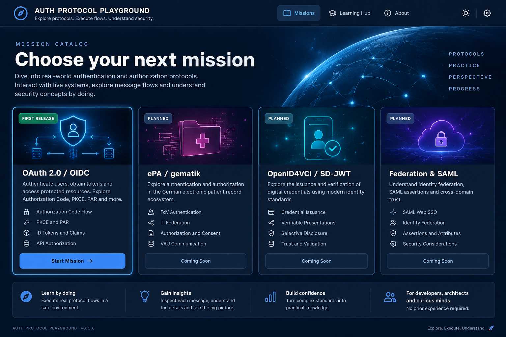

# Mission Catalog — UX Design

**Status:** DRAFT FOR REVIEW · **Screen:** `/missions`

## Purpose

**Authorized UI Slice 001:** OAuth is labeled **Fixture preview** with a working **Preview fixture** link. ePA remains **Planned** with a working **Preview concept** link to its layout-only fixture. Neither card offers a runnable mission. Only these two entries and real navigation are included.

Visitors should immediately understand which protocol missions exist, what each teaches, which can be run, and how to begin.

## Primary hierarchy

```text
Global Header: Brand | Missions | About/Docs (only if real destinations)
Intro: Learn authentication and authorization by running flows
Mission Grid:
  [OAuth 2.0 / OIDC]      [ePA / gematik]
  Runnable after verified   Planned; no runnable CTA
Optional: How Mission Control works
```

## Mission card design

Minimum fields: `title`, `oneSentenceOutcome`, `topics`, `availability`, and an action that matches that availability. Optional: difficulty/duration **only if grounded**, artwork, mission version. All cards use the same layout; card details belong to the mission definition.

### Availability and CTA behavior

| Availability            | CTA                                                               | Behavior                                 |
| ----------------------- | ----------------------------------------------------------------- | ---------------------------------------- |
| Draft / not deployed    | Preview concept (only if a real preview exists), otherwise no CTA | Must not claim runnable status           |
| Available / verified    | Start mission                                                     | Opens the workspace for that mission     |
| Planned                 | Planned / Learn more (if page exists)                             | Must not initiate unavailable operations |
| Temporarily unavailable | Unavailable                                                       | Explains non-sensitive reason when known |

The **design mockup** may label OAuth “Available” to illustrate its future state. The actual app must not show this until the flow is verified.

## Interaction states to design

The approved frontend-only `mission-control-design-foundation` refinement preserves this two-card layout and working preview navigation. Shared catalog notices use mission-neutral wording; mission names and specific cautions belong to mission declarations. Availability remains Fixture preview / Planned until a real integration is separately verified.

The 2026-10-18 visual refinement uses a compact globe/network hero and distinct code-native mission illustrations, following the reference imagery. Artwork carries the availability badge; shared card anatomy aligns titles, outcomes, topics and preview actions. Quiet inline notices and spacing provide hierarchy without nested bordered cards. Decorative artwork is not interactive, describes no observed traffic and stays outside the accessibility tree.

Default, hovered, focused (keyboard), loading, available, planned, temporarily unavailable, and empty catalog. Avoid decorative clickable elements without an action. Initially omit searching, filters and sorting: two cards do not warrant them.

## Layout guidance

- Single responsive website; no mobile app. Two columns on large viewports, one column on narrow ones.
- Readable titles and short descriptions are higher priority than artwork.
- A compact visual hero is acceptable; no oversized space imagery obscuring mission selection.
- Clear route back to Catalog from Workspace.

## Open design review questions

- Is an introduction overlay worthwhile for new learners, or should help be inline?
- How prominently should planned missions appear without stealing attention from the runnable mission?
- Does card artwork aid scanability or distract from the learning outcome?

## Acceptance walkthrough

Given the catalog with one available and one planned mission, a visitor can select the available mission with a keyboard; the planned card cannot start a fake flow; the visitor can identify availability without relying on color.

**Visual reference (embedded):**



See [visual-references.md](visual-references.md) for the elements to preserve and the illustrative elements to omit. The image contains speculative controls and mission cards, not an authoritative screen specification.
