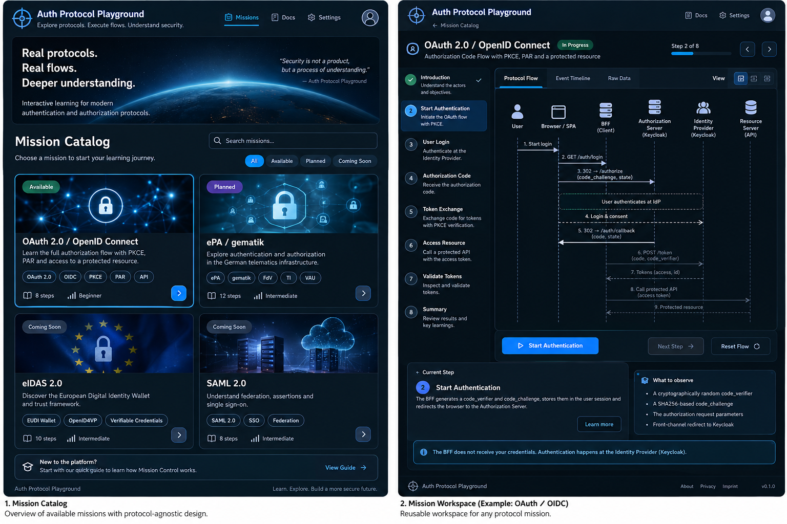

# Mission Control Workspace — UX Design

**Status:** APPROVED BASELINE — LOCAL/PRIVATE `001-oidc-pkce` · **Screen:** `/missions/:missionId/workspace`

## Goal

**Public-release preparation:** approved `public-playground-oauth-deployment` tasks 1.1–5.2
prepare isolated production execution using the existing Workspace, actions and safe
observations. Preserve layout, accessibility, localization and fixture/conceptual behavior;
this authorizes no public activation or live backend cutover. See the
[scope record](../../openspec/changes/public-playground-oauth-deployment/repository-verification.md#preparation-authorization).

Localization follows Accepted ADR-0004. The global Deutsch/English control updates all workspace copy and accessible text without resetting the mission, retained checkpoint, loaded samples, inspection selection or map scale. Technical evidence values remain literal; translated annotations preserve fixture/conceptual/not-observable provenance. Longer labels wrap with existing responsive layout and diagram-local scrolling.

**Authorized UI Slice 001:** Both workspaces begin with an empty timeline. OAuth can explicitly load labeled fixture samples; they have no actual observer, timestamps, authentication result or network execution. ePA is a conceptual actor/checkpoint layout with no operational results. Replay explanation navigates loaded samples; Reset view clears selection and restores canvas scale without deleting samples. No Retry flow or Sign out control is exposed because there is no execution or session.

Let learners execute a mission, understand participating actors, select recorded events, and inspect **safe evidence** and explanatory teaching content. Generic UI must function for OAuth **and** a conceptually different ePA fixture.

## Default desktop information hierarchy

```text
┌─────────────────────────────────────────────────────────────────────────────────────┐
│ Back to Missions     {Mission title}       {Run/learning status}      Help           │
├─────────────────────┬─────────────────────────────────┬─────────────────────────────┤
│ MISSION PANEL       │ PROTOCOL CANVAS                 │ EVENT INSPECTOR             │
│ Objective           │ Mission-defined actors         │ What happened               │
│ Learning checkpoints│ Request/response links         │ Observed safe evidence      │
│ Contextual action   │ Front vs back channel          │ Explanation                 │
│                     │ Logical roles, grouped systems │ Roles / channel / recovery  │
├─────────────────────┴─────────────────────────────────┴─────────────────────────────┤
│ EVENT TIMELINE (observed events only; order, status, event selection, timestamps)    │
└─────────────────────────────────────────────────────────────────────────────────────┘
```

On narrower browser windows, the inspector moves below the canvas; no separate mobile app is planned. Canvas must remain usable via keyboard and a text alternative.

## Generic shell ownership

### Mission Control design foundation

The owner authorized `mission-control-design-foundation` as a frontend-only refinement. Retain vertical swimlanes and the existing panel structure. After samples load, show all defined communication paths lightly, using source/destination anchors and arrowheads. The selected path, its actors, timeline button and inspector share one interaction identity. Actor selection clears the active interaction; learning checkpoint selection changes context without executing or creating events. The retained learning checkpoint is independent of the active inspection selection.

Internal checks use a distinct actor-local annotation with a **Not observable** label and no network arrow. Channel labels come from mission definitions; solid, dashed and annotation styles accompany text in the legend and structured diagram alternative. The conceptual ePA fixture continues to define no operational interactions or telemetry.

Use readable normal text for selected explanations, inspector content and controls. Essential content remains available through panel stacking, an independently scrollable map, and the structured text alternative at narrow widths or increased browser zoom. Fixture loading is synchronous: empty and loaded states are real; asynchronous loading/error and live outcomes are not fabricated.

The 2026-10-18 refinement keeps participant centers, lifelines and arrow endpoints in one scrollable coordinate system. Message labels take their natural wrapped height above a separate arrow/annotation band, preserving explanation order without fixed-height row collisions. Supporting panels are quieter than the canvas, and an active row has a visible Selected badge plus matching actors/path/Inspector. Fit returns to the readable 100% map scale; it stops shrinking essential text and retains horizontal scrolling. Browser page zoom remains independent of map controls. Inspector access and keyboard focus survive panel reflow.

- Routing, title, mission selection, work area, actor and event selection.
- Layout, zoom/fit behavior, visual highlighting and accessibility.
- **Learning progress** (selected checkpoint) vs **run status** (actual auth/API result).
- Event list display, event selection, explanatory panel design, empty/error states.

## Mission-owned content

- Actor identifiers, labels, logical grouping (e.g. Keycloak hosting AS + IdP), role descriptions.
- Learning checkpoints, available actions, explanations, safe evidence definitions.
- Execution adapter behind actions and observable events; BFF integrations are mission-specific.

Do not put OAuth-specific UI copy, `code_verifier` names, or authentication status transitions in generic Workspace components.

## User states / actions

| UI state                      | Presentation                                             | Action                                                  |
| ----------------------------- | -------------------------------------------------------- | ------------------------------------------------------- |
| No run                        | Conceptual actor map, timeline empty and labeled         | Start mission-specific action                           |
| Navigating to provider        | Explain redirect before leaving the website              | Browser performs normal redirect; no fake step debugger |
| Returned, pending             | Show only what is actually known                         | Disable conflicting re-entry actions as needed          |
| Authenticated (OAuth example) | Session status and observed event list                   | Fetch synthetic protected resource                      |
| API permitted / denied        | Real result and validated reason when available          | Inspect event / retry when supported                    |
| Failed or cancelled           | Safe error and next recovery option                      | Retry flow creates a **new** transaction                |
| Signed out                    | Local session ended; old run remains inspectable if safe | Start new run                                           |

**Commands must not be conflated:** `Replay explanation` navigates existing recorded events; `Retry flow` creates new network operations; `Reset view` clears UI selection; `Sign out` invalidates the BFF session. Never imply these are synonyms.

## Proposed standard runtime behavior

**Owner acceptance, 2026-11-11:** the owner accepted this reconciled UX/visual baseline and approved the local/private integration in `001-oidc-pkce`. This step records the decision only; it does not change current fixture availability or start implementation. The accepted design uses the existing panels and contextual-action area; there is no visual redesign. The [system context](../architecture/system-context.md) and [integration design](../../openspec/changes/001-oidc-pkce/design.md) define the component, API and security contracts.

### Navigation and restoration

A separately enabled, verified OAuth runtime binding provides the mission-specific Start authentication action. It performs normal top-level navigation to `GET /api/oauth/login` in the existing NestJS auth-client/BFF, which redirects to Keycloak's UI. The SPA is the user agent/UI, the BFF is the confidential OAuth client, Keycloak hosts AS and IdP roles together, and existing HAPI FHIR is the independent Resource Server.

The proposed standard callback is `GET /api/oauth/callback`. A correlated success, provider denial or exchange/validation failure returns by clean 303 to `/missions/oauth-oidc/workspace`, without codes, state, error text or arbitrary return URLs. The mission adapter restores via `GET /api/oauth/session` and browser-owned `GET /api/oauth/runs/:runId/events`. Refresh performs those reads only; it does not replay authentication or resource operations. While restoration is pending, show only known state and disable conflicting execution. Missing/expired/restarted context offers a fresh login rather than reconstructing a session or trace.

Keep fixture previews separate from runtime records, with explicit sample loading and no fabricated observer or timestamp. No credentials or run/session state go into localStorage/sessionStorage; explicit locale choice remains the only existing persisted frontend preference.

### Runtime states in the existing Workspace

| State/action                      | Required presentation and effect                                                                                                                                     |
| --------------------------------- | -------------------------------------------------------------------------------------------------------------------------------------------------------------------- |
| Start / navigating                | Explain the real redirect before leaving; no manual Next step control for Keycloak and no password form in Mission Control                                           |
| Correlated return                 | Restore authentication, run identity and safe observations; success cannot be inferred merely from visiting the return route                                         |
| Failed / cancelled / lost context | Safe localized outcome and Retry; a retry creates a new transaction rather than replaying a consumed callback                                                        |
| Authenticated                     | Offer the mission-specific synthetic-resource action; authentication and resource outcome are separate                                                               |
| Resource request                  | `GET /api/oauth/resource` calls the configured `GET /fhir/Basic/playground-demo` through the BFF with a server-held Access Token; no arbitrary URL/resource controls |
| Resource denied / unavailable     | Distinguish missing/expired BFF authentication, HAPI 401/403 and unavailable upstream without inventing causes or discarding eligible safe history                   |
| Local Sign out                    | `POST /api/oauth/logout` uses configured Origin and context-bound anti-CSRF checks; reflect authoritative unauthenticated state and remove resource capability       |
| Replay explanation / Reset view   | Navigate retained explanation or clear selection/restore map scale only; do not create network operations or end authentication                                      |

A successful standard logout invalidates the active application session, removes credentials and cancels all context-bound pending attempts, including an already consumed callback still awaiting exchange/validation. The callback must recheck original context/attempt eligibility after all asynchronous work and before a synchronous session commit. A stale completion cannot authenticate, issue an authenticated cookie or overwrite the replacement unauthenticated viewing context. A later fresh login can use existing Keycloak SSO; local sign-out does not claim provider-wide logout or bearer revocation. Other browsers and existing ePA/PAR behavior remain independent.

The Workspace must show signed out even when trace storage is full or recording logout fails. Cleanup/cancellation must not depend on storing an event. Mark an unrecorded observation/trace completeness unavailable; never invent a logout event, timestamp or sequence or display a complete-trace claim.

After logout, the rotated unauthenticated context may inspect only its existing owned, non-sensitive history under the original fifteen-minute lifetime. A run ID alone grants no access and history cannot restore resource permission. Collections remain bounded to 1000 entries and runs to 100 events. Ordinary execution may be rejected at capacity before external work; logout, cancellation and cleanup remain available.

### Evidence, explanation and component ownership

Version-1 observed events carry stable run/event IDs, per-run sequence, actual observer/time, kind, actor references, channel, outcome and per-kind typed allowlisted evidence. The mission adapter validates and projects the wire contract into neutral protocol-flow presentation. Unsupported versions/kinds/fields or unsafe evidence produce a safe unavailable/incomplete state with no raw JSON fallback.

The BFF observes its own outcomes and received responses. HAPI decision/reason evidence is shown only from the configured upstream's bounded `X-Playground-Decision`/`X-Playground-Reason` report: the response event is `observedBy: auth-client` at the BFF's time, with a nested `reportedBy: res-server` decision. Absent, malformed or conflicting reports leave the reason unavailable. A BFF rejection before an upstream request is never a HAPI denial.

The earlier fixture actor-local annotations remain **Not observable**. The proposed neutral observed variant can represent an actual BFF-local check without a network arrow. Keycloak's internal password/PKCE/token checks stay **Explained / Not observable**, with no invented observer/time or internal-check success list. Distinguish these from real front-channel and back-channel observations in the diagram, timeline and Inspector.

Never expose passwords, tokens, codes, state/nonce, verifiers, secrets, cookies, raw callbacks/identity claim sets or full HTTP bodies in evidence or routine logs. Resource data is a bounded synthetic result, not an HTTP-body trace. The context-bound logout anti-CSRF value is for the request header only, never teaching evidence.

Preserve mission/protocol-flow ownership and public imports under Accepted ADR-0003. Generic controls must not branch on OAuth/ePA IDs or validation details. The ePA preview remains conceptual with no operational telemetry; existing backend ePA `/login`, `/callback`, `/session` and required-PAR behavior remain separate.

### Verification and approval boundary

**Implementation alignment, 2026-11-13 (tasks 8.1–8.6):** the existing Workspace now has an
explicit private Vite binding. Start/Retry uses top-level navigation; return/refresh reads
only owned session/events. Resource and local logout remain separate actions, with native
Origin and context-bound CSRF. Authoritative signed-out state commits before event retrieval;
capacity/recording failure keeps eligible safe history visibly incomplete. Late results do
not restore signed-out UI state. Pending/failed current attempts disable resource execution
without relabeling an earlier retained application authentication as a success for that run.
Replay/Reset/checkpoints/selection remain presentation-only. German/English switching
preserves run/event identity, learning selection and map scale. The renderer accepts a
neutral observed variant, including arrowless BFF-local observations and separately reported
HAPI decisions; runtime and fixture records are never merged.

The existing stylesheet/artwork and panel hierarchy are preserved. The private state/action
copy occupies existing status/objective/action areas. Default builds and public hosting
remain fixture-only, and catalog availability stays unverified. See the [private runtime
guide](../../apps/playground/README.md#explicit-private-execution) and [task 8 verification](../../openspec/changes/001-oidc-pkce/spa-runtime-verification.md).
This alignment does not start group 9 or change the accepted design/ADRs.

The [revised acceptance specs](../../openspec/changes/001-oidc-pkce/specs/mission-experience/spec.md) cover restoration, owned evidence, lifecycle/recording failures and the unchanged visual contract. Verify keyboard/focus, actor/event/checkpoint selection, reduced motion, diagram text alternative, Fit/scrolling, German/English at narrow widths and actual 100%/200% browser zoom when runtime behavior is implemented. Language changes translate presentation only and retain navigation, run identity, event selection and map scale.

The [consolidated readiness and owner approval record](../../openspec/changes/001-oidc-pkce/readiness-review.md#consolidated-owner-approval-summary) records the accepted baseline and local/private authorization. It does not replace future browser/security acceptance execution. The public static site remains fixture-only; no public authentication deployment is authorized.

## Event inspector: required content order

1. **What happened:** name, timestamp if observed, actual observer.
2. **Safe Evidence:** allowlisted, typed details only. If unavailable, say so plainly.
3. **Why it matters:** educational interpretation, separate from the evidence block.
4. **Actors & channel:** explicit origin/destination; front-channel browser redirect vs backend call.
5. **Failure/recovery** only when applicable.

### Non-negotiable truthfulness

- UI must distinguish **Observed**, **Explained**, and **Not observable** states.
- Do not claim Keycloak’s internal PKCE check was recorded by the BFF. A successful code exchange is an _outcome observed by BFF_, not a provider-internal instrumentation trace.
- The real authorization request leaves the SPA and redirects the browser to Keycloak. No ability to pause/single-step Keycloak is implied.
- No raw password, authorization code, Access/ID/Refresh token, cookie, PKCE verifier, secret or full redirected URL in frontend events or logs.
- AS/IdP may be distinct _logical roles_ inside one **Keycloak** grouping. Do not visually imply two servers are deployed.

## Design validation with two fixtures

The generic Workspace must display both [`fixtures/oauth-oidc.md`](fixtures/oauth-oidc.md) and [`fixtures/epa-concept.md`](fixtures/epa-concept.md) **without changing the shell's hardcoded copy or branching on mission IDs**. The ePA fixture is solely a UX validation tool, not authorization to implement ePA or claim gematik compliance.

## Interactions requiring high-fidelity review

1. Empty canvas versus completed run.
2. Selecting a message highlights its actors and safely populated inspector.
3. Selecting a _learning step_ does not falsely trigger a real network request.
4. Authenticating leaves the app for Keycloak and returns to the same mission run.
5. Error, expired, cancelled, denied, logout and retry states.
6. Keyboard order, focus ring, canvas text alternative, browser zoom and reduced motion.

**Visual reference (embedded):**



See [visual-references.md](visual-references.md) for guidance. The illustrative sequence lines are **not** an authoritative protocol trace. “Raw Data” must be renamed **Safe Evidence**.
