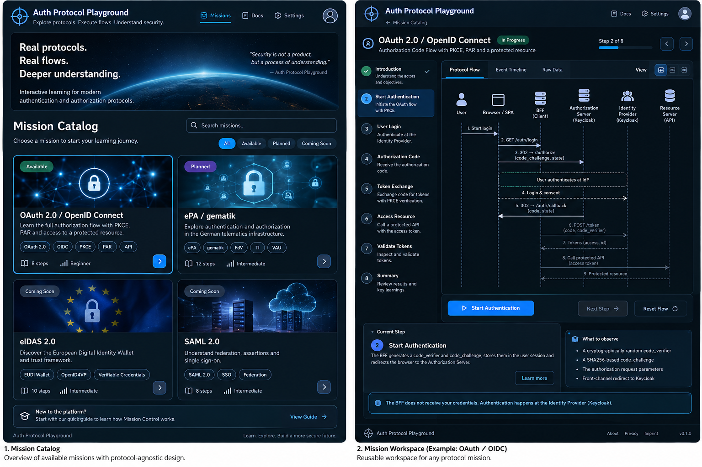

# Visual References — Mission Control

**Status:** Design reference for the first UI slice.

These two images belong to the project's UX baseline. Review them before implementing the Mission Catalog or the Mission Workspace; do not substitute an unrelated generic dashboard template.

## 1. Mission Catalog

**Carry into the UI:** dark navy surfaces; restrained blue/cyan emphasis; well-spaced mission cards; prominent mission selection; consistent status labeling; descriptive mission content.

**Adapt deliberately:** the mockup includes speculative mission families, metrics, menu items, banners and "available" labels. Implement only actual catalog entries and navigation. Do not mark the OAuth mission executable until its integration is verified. Avoid decorative controls without a working action.

**Details:** [mission-catalog.md](mission-catalog.md).

## 2. Mission Control Workspace

**Carry into the UI:** persistent context of current mission; left-side objectives; central actor/sequence visualization; accessible step selection; compact explanation/inspector; dark technical visual language.

**Adapt deliberately:** the sample sequence is illustrative, not an exact OAuth trace. It must not imply step-by-step control over Keycloak internals. Replace the mockup's "Raw Data" tab with **Safe Evidence**; differentiate **Observed**, **Explained** and **Not observable**. The Shell must also work with the ePA fixture.

**Details:** [mission-workspace.md](mission-workspace.md) and [visual-system.md](visual-system.md).

## Implementation rule

Use the PNGs as **visual targets**, and the Markdown design/specifications as the source of truth for behavior and protocol correctness. Where a visual detail conflicts with a requirement, implement the requirement and briefly record the adaptation. No pixel-perfect replication requirement; preserve the recognizable layout, hierarchy, and styling.

The first UI slice uses clearly labeled demo events only. It must not show a fake successful authentication or expose secrets.

## Approved runtime artwork

The owner explicitly requested reuse of these existing images on 2026-10-19. All were visually inspected, including their actual subjects; filenames alone were not used to infer placement. Runtime copies live in `apps/playground/public/assets/` with original names, JPEG formats and bytes. Components use `/assets/` URLs, never the documentation directory.

| Original filename               | Dimensions | Aspect ratio           | Verified subject and usage                                                                                                                     |
| ------------------------------- | ---------- | ---------------------- | ---------------------------------------------------------------------------------------------------------------------------------------------- |
| `epa-card-header.jpg`           | 800 × 400  | 2:1                    | Magenta medical folder and security/network symbols; current ePA mission card                                                                  |
| `oauth-card-header.jpg`         | 800 × 400  | 2:1                    | Cyan identity shield with server arrows; current OAuth/OIDC mission card                                                                       |
| `openid-card-header.jpg`        | 800 × 400  | 2:1                    | Cyan mobile credential with verification check; matches the reference's OpenID4VCI / SD-JWT card, not an additional current OIDC-login mission |
| `saml.jpg`                      | 800 × 400  | 2:1                    | Purple federation/security cloud connecting organizations; future matching SAML card                                                           |
| `mission-catalog-hero-wide.jpg` | 2172 × 724 | 3:1                    | Wide Earth horizon and star field; catalog hero above 760 CSS px                                                                               |
| `mission-catalog-hero.jpg`      | 1672 × 941 | approximately 1.7768:1 | Right-aligned Earth/network globe with darker left sky; alternative hero at 760 CSS px and below                                               |

Only OAuth/OIDC and ePA missions are registered. The OpenID credential and SAML files are copied and verified as loadable, but are not rendered as placeholder cards. Adding those missions requires separately defined content and behavior.

`Catalog.tsx` owns the small artwork-path mapping. A responsive `<picture>` selects the hero. Following the owner's full-width correction, its background spans the viewport independently of the centered text/card column. `object-fit: cover` fills that background without distortion; centered desktop framing preserves the horizon, and right-centered narrow framing preserves the planet focal point. Cropping is intentional to fill the hero band. The existing 180px card-art area also uses centered `cover`: decorative edges may crop to fit the fixed card frame, while the central shield/folder focal points remain visible. Explicit dimensions and the existing reserved frames prevent image-load layout shifts. Images are decorative (`alt=""`, within an aria-hidden artwork region); localized titles/status/actions remain ordinary text. A dark overlay keeps hero copy legible without reconstructing the planet in CSS. Functional protocol diagrams, arrows and icons remain independent of these images.
