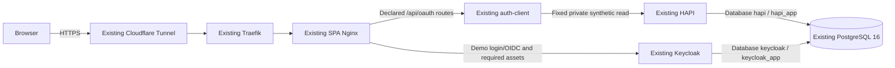

# Design

**Status: DRAFT — proposed decisions for review; no implementation or deployment approval.**

## Context

See [proposal.md](proposal.md) for motivation and
[change 001 verification](../001-oidc-pkce/verification-report.md) for the preserved baseline.
Read-only inspection on 2026-11-13 found:

| Area          | Observed boundary / required extension                                                                                                                                                                                           |
| ------------- | -------------------------------------------------------------------------------------------------------------------------------------------------------------------------------------------------------------------------------- |
| SPA           | `app/runtime.ts` and `vite.config.ts` enable execution only in private Vite serving mode; production builds compile it off.                                                                                                      |
| Nginx/hosting | `apps/playground/nginx.conf` is static-only. The external watched `infra/traefik/dynamic/epa-lab.yml` sends the existing hostname to that Nginx.                                                                                 |
| BFF           | Existing routes, schemas, bounded sessions and token validation work; `configuration.validation.ts` still assigns the legacy issuer to the standard profile.                                                                     |
| Keycloak      | Existing 26.8.0 instance uses `start-dev`, `KC_DB=dev-file`, private hostname `http://192.168.178.131:5555`; host port 5555 currently binds all interfaces.                                                                      |
| HAPI          | Reviewed canonical commit is `e65bafc279f02f44b19b47ca7326015886047a63`. Host-only recreation omitted the private overlay's memory/heap/seed settings; data/authentication checks remain implemented.                            |
| PostgreSQL    | Existing `res-server-db` uses PostgreSQL 16 and `res-server-data`. Catalog-only checks confirmed bootstrap administrator `hapi` is OID 10 and also HAPI's runtime account; see B1 evidence below. No application rows were read. |
| Edge          | Traefik v3.0 and cloudflared share `dev-proxy`; public port 80 is published. Remote Tunnel ingress/cache/log policy is not established by local configuration. Privileged UFW inspection remains pending.                        |

## Goals / Non-Goals

**Goals:** one reviewed public binding of the existing mission, independent provider/resource
trust, legacy compatibility, and a host lifecycle that reproduces the accepted settings.
Owner-confirmed access is individual provisioned demo accounts with no public registration.

**Non-Goals:** another BFF/Resource Server/Keycloak/PostgreSQL instance, public Vite, distributed sessions,
SSO-wide logout, public ePA execution, self-service accounts, clinical data or a visual redesign.
One BFF replica retains the accepted process-local lifetimes and restart semantics.

## Decisions

### 1. One public origin through the existing Nginx

Keep `https://auth-playground.yappai.de`; no additional public hostname is needed.

Add an explicit production OAuth build/target using the existing compiler and final Nginx
runtime. Default builds stay fixture-only; query strings cannot enable execution. Keep the
existing mission-owned API adapter and neutral renderer. The public candidate uses the
existing Workspace, top-level login navigation and exact callback
`https://auth-playground.yappai.de/api/oauth/callback`.

Nginx forwards the six declared API operations, with exact methods and owned-run path shape,
to the current private BFF. It joins the existing private backend network as well as
`dev-proxy`; preserve the BFF's host networking/private port-3000 ePA contracts. Unknown API
routes and legacy `/login`, `/callback`, `/session`, `/epa`, `/fhir`, `/admin`, other realms and
management paths are explicit denials, not SPA fallbacks. Only normal application navigation
receives `index.html`. Alternatives: public Vite and a new gateway service add unjustified
runtime dependencies; a second API hostname introduces unnecessary CORS/cookie boundaries.

Select the backend network as Nginx's egress gateway so host BFF traffic uses the existing
approved bridge/source-subnet firewall path; verify the actual source address after start.

### 2. Isolate the public issuer inside the existing provider

Propose realm `playground-public`, with frontend URL `https://auth-playground.yappai.de` and
issuer `https://auth-playground.yappai.de/realms/playground-public`. Reuse confidential client
ID `playground-oidc` in that realm with a new server-held secret, exact callback, S256,
Code-only/no PAR, RS256 tokens, audience `playground-fhir` and optional permission `demo.fhir.read`.
The definition contains no legacy client, seeded shared user or inherited administrative
roles. Reuse existing managed-client tooling with explicit realm ownership and idempotent
conflict detection; never import the whole `epa-demo` fixture into the public realm.

Keep the global private hostname and existing `epa-demo` configuration/credentials unchanged.
Keycloak documents realm-level frontend URL configuration; proving the pinned version's
dual-realm discovery, token issuer and login behavior is a blocking compatibility test,
not a capability claimed verified here. [Hostname configuration](https://www.keycloak.org/server/hostname)

Public provider routes allow only this realm's discovery, authorization, token, keys,
necessary login-actions and login/common assets. Exclude account/admin consoles, administrative
assets, `master`, `epa-demo`, dynamic client registration and unused protocol interfaces.
Derive the final narrow asset/action allowlist from the real login and required-password-change
tests. Keycloak recommends restricting administrative and management paths at the proxy.
[Reverse-proxy guidance](https://www.keycloak.org/server/reverseproxy)

Alternative: moving `epa-demo` to a public issuer would change its token/callback contract.
This design avoids that migration. If realm-level separation cannot preserve ePA, stop for
an independently verified, separately reviewed compatibility revision; do not change the
global issuer or start a second provider silently.

### 3. Reuse PostgreSQL 16 with separate databases

**Revised owner architecture decision, 2026-11-13:** use the existing PostgreSQL 16
`res-server-db` service/container and its existing `res-server-data` persistent volume.
This retains the shared-instance decision and resolves B1 through runtime-account separation.
Add no PostgreSQL container or production database volume, and publish no PostgreSQL port.
The change stays DRAFT. The owner's planning instruction explicitly replaces the earlier
freeze of HAPI runtime credentials/permissions with the scoped migration below; logical
data/schema preservation and administrative recovery remain mandatory. No live change is authorized.

| Consumer       | Database / login role               | Required boundary                                                                                                                       |
| -------------- | ----------------------------------- | --------------------------------------------------------------------------------------------------------------------------------------- |
| HAPI           | Existing `hapi` / new `hapi_app`    | Same private JDBC URL; own application objects and required schema privileges only; independent runtime secret.                         |
| Keycloak       | New `keycloak` / new `keycloak_app` | Private `jdbc:postgresql://res-server-db:5432/keycloak`; own migration/runtime objects and independent secret.                          |
| Administration | Existing bootstrap `hapi`, OID 10   | Retain administrator identity/password, database/system ownership and verified operator recovery; never configure it in an application. |

**Read-only B1 evidence, 2026-11-13:**

- Container `epa-lab-res-server-db` reports PostgreSQL 16.15, image ID
  `sha256:0cefaabd882e42bcb2a2f3dc56d3ce4770560ba62fd7f197f1a2e008fd5731ab`,
  volume `epa-lab_res-server-data` at `/var/lib/postgresql/data`, no published 5432 binding.
- `hapi` is the only login role: OID 10, SUPERUSER/CREATEDB/CREATEROLE/REPLICATION/BYPASSRLS,
  unlimited role connections, no membership rows for that role. `hapi_app`, `keycloak_app`, role `keycloak`
  and database `keycloak` are absent. Database `hapi` and the control/template databases
  are owned by `hapi`; `public` is owned by `pg_database_owner` with PUBLIC USAGE only.
- `hapi.public` has 60 tables, 48 sequences and 184 indexes, all owned by `hapi`, with default
  ACLs and no PUBLIC table/sequence grants. There are no public-schema routines or custom
  default-ACL entries. The sole installed extension is administrator-owned `plpgsql` 1.0 in
  `pg_catalog`; no public relations are extension members. Inventory names include HAPI's
  `hfj_*`, `bt2_*`, terminology, package and related tables; counts alone are not a transfer allowlist.
  No large objects, foreign servers/wrappers or settings for the inspected application/global
  role scopes were present in the additional dependency catalogs.
- Database `hapi` has default PUBLIC CONNECT/TEMPORARY. HBA currently permits local/loopback
  `trust`, then broad host SCRAM. There are no per-application database restrictions.
- Filtered runtime inspection confirmed HAPI logs in as `hapi` and its password equals the
  bootstrap password; only the equality result was emitted. Keycloak still uses `dev-file`.
  No matching bootstrap-secret value was found in the inspected BFF, Keycloak or public/private
  Playground environments; these checks emitted key names/Boolean results only.
  The source specifies Hibernate `hbm2ddl.auto=update`, Flyway disabled and Hikari maximum 10;
  inspected HAPI environment has no override for those pool/DDL settings.

The checks used `docker inspect` and `docker exec --user postgres epa-lab-res-server-db psql
--no-psqlrc --no-password --username=hapi --dbname=hapi --set=ON_ERROR_STOP=1`, with catalog
queries inside `BEGIN READ ONLY` / `COMMIT`. Catalogs inspected: `pg_roles`, `pg_database`,
`pg_namespace`, `pg_class`, `pg_type`, `pg_proc`, `pg_extension`, `pg_depend`, `pg_auth_members`,
`pg_default_acl`, effective ACLs via `aclexplode`/`acldefault`, `pg_hba_file_rules`, settings and
grouped session counts, plus `pg_largeobject_metadata`, `pg_foreign_server`,
`pg_foreign_data_wrapper` and setting names in `pg_db_role_setting`. No application rows,
password hashes or secret values were output.

**Bootstrap recovery and credential dependencies:** OID 10 is PostgreSQL's bootstrap
superuser, and PostgreSQL 16 rejects removal of that identity's SUPERUSER attribute. Do not
demote, rename, delete or replace it, or transfer its system/cluster ownership.
[Bootstrap catalog](https://raw.githubusercontent.com/postgres/postgres/REL_16_STABLE/src/include/catalog/pg_authid.dat),
[PostgreSQL 16 role checks](https://raw.githubusercontent.com/postgres/postgres/REL_16_STABLE/src/backend/commands/user.c)

Keep `POSTGRES_DB=hapi`, `POSTGRES_USER=hapi`, its existing password and the data mount.
`infrastructure/docker-compose.host.yml` currently passes `RES_SERVER_DB_PASSWORD` both to
PostgreSQL and HAPI. Plan to retain that setting for bootstrap/administration only; HAPI
must use `SPRING_DATASOURCE_USERNAME=hapi_app` and new `HAPI_APP_DB_PASSWORD`, while Keycloak
uses `KC_DB_USERNAME=keycloak_app` and separate `KEYCLOAK_DB_PASSWORD`. Update the canonical
manifest, `.env.example`, `setup-env.mjs`, managed secret handling, their focused tests and
active operations/credential documentation together after approval. Preserve existing
secrets on rerun; no password in arguments, logs, images or browser variables. Never use
first-start initialization to change an initialized database.

Check integration/private overlays, ordinary host/Yoster recreation and restore jobs for
inherited credentials; fresh integration setup must provision a restricted application role
before HAPI starts rather than inherit bootstrap application access. The independent
submodule's example Compose uses another bootstrap
account for its own volume; do not run it against this volume or silently treat it as the
canonical host path. The current `pg_isready -U hapi -d hapi` is a server-availability probe,
not authenticated application SQL; retaining that hint does not justify administrator
credentials in HAPI. Verify application readiness separately using `hapi_app`.

**Minimum ownership and privilege delta:**

- Both runtime roles have LOGIN only when ready, NOSUPERUSER/NOCREATEDB/NOCREATEROLE/
  NOREPLICATION/NOBYPASSRLS, finite connection limits and no memberships or SET ROLE path
  to the administrator, peer application or powerful predefined roles. Grant neither
  database ownership nor database-level CREATE; bootstrap retains database/schema ownership.
- On each application database revoke default PUBLIC CONNECT/TEMPORARY, grant CONNECT to
  its own runtime role, and give that role USAGE/CREATE on the existing `public` schema,
  removing PUBLIC schema access. This is an explicit journaled HAPI ACL change. Preserve
  built-in catalog/language access; grant TEMPORARY or additional privileges only if a
  reproducible migration test proves a specific need and records the reviewed delta.
- Hibernate schema update needs ownership for ALTER/index/constraint operations, beyond
  DML grants. Transfer only the reviewed HAPI-managed tables/sequences in `hapi.public` to
  `hapi_app`; verify dependent indexes, row/array types and owned sequences follow correctly.
  Journal each old/new owner and ACL, and retain table/sequence values and logical definitions.
  Keycloak creates/owns its own tables/sequences and migration locks as `keycloak_app`.
- Do not use blanket `REASSIGN OWNED BY hapi`, `DROP OWNED`, catalog edits or schema-wide
  grants without an inventory. Exclude databases, tablespaces, system schemas/objects and
  extension members from transfer. Keep extension installation/upgrades administrator-only;
  a new privileged DDL requirement blocks release for review, not a superuser grant to an app.

This retains the existing automatic schema-migration model with only own-schema DDL; the
runtime owners necessarily can alter/drop their own objects. It is not a read-only database
account or a change to FHIR authorization. Splitting out another migration service/framework
or granting bootstrap-role membership would add scope or defeat the boundary.
[Ownership privileges](https://www.postgresql.org/docs/16/ddl-priv.html),
[ALTER TABLE](https://www.postgresql.org/docs/16/sql-altertable.html),
[REASSIGN OWNED scope](https://www.postgresql.org/docs/16/sql-reassign-owned.html)

**Private authentication rules:** insert exact-role rules before the observed broad
local/loopback trust and host SCRAM entries. Allow each runtime role only its own database
from its verified application peers using SCRAM; reject that role for all other database/
source combinations, including local sockets, IPv4/IPv6 loopback, control/template databases
and replication. Do not let a loopback/local trust rule substitute for password verification.
After draining old HAPI connections, reject bootstrap `hapi` on TCP; retain and independently
test its existing operator-only Docker/Unix-socket recovery path before and after reload.
Applications receive no administrator secret, data-volume/socket or Docker access. Trusted
OS/Docker administrators remain cluster administrators, an explicit boundary rather than
isolation from the recovery administrator. Validate first-match ordering and parse errors,
reload without shared-server restart, and test real logins from actual application peers;
an ACL check or SET ROLE simulation alone is insufficient.
[Authentication rules](https://www.postgresql.org/docs/16/auth-pg-hba-conf.html)

**Idempotent migration procedure, to implement only after approval/rehearsal:**

1. Capture container/volume identity, administrator recovery proof, protected secrets, both
   backup procedures and baseline object/ACL/data/sequence fingerprints. Review the complete
   dependency inventory and exact allowed owner/ACL/HBA deltas. Serialize administration
   with a control-database lock and protected journal; abort on unknown objects/clients.
   Compare data/sequence preservation while writes are frozen; record legitimate later
   application changes separately from the ownership/ACL migration.
2. Create only missing journal-owned `hapi_app`/`keycloak_app` roles initially NOLOGIN and
   database `keycloak` owned by the retained administrator. Database creation is a separate
   non-transactional step. Conflicting names/owners/credentials fail closed; reruns verify
   existing managed secrets without rotating them or adopting an unrelated resource.
3. Freeze HAPI writes, stop only HAPI and drain its old connections. Within a bounded-lock
   transaction apply the inventoried HAPI object-owner/ACL changes; provision scoped
   Keycloak schema access separately. Install/validate/reload journaled HBA restrictions,
   preserve the independent recovery path and enable only ready runtime logins.
4. Switch only application credential references. Verify real `hapi_app` startup, Hibernate
   migrations, fixed synthetic read, restart and security regressions before provider work.
   Migrate Keycloak from its consistent embedded copy as `keycloak_app`; verify production
   startup, users/keys/client credentials and private ePA/PAR before enabling public ingress.
5. Prove own-database DDL/DML and two-way cross-database denial using real SCRAM logins;
   reject bootstrap TCP, privileged role/SET ROLE and system/extension administration.
   Repeat provisioning and ordinary application recreation: expected metadata is a
   verified no-op, data/sequence values are preserved and neither app resumes admin use.
6. On failure keep ingress closed. Abort an uncommitted ownership transaction; otherwise
   retain committed data/roles and use only the journaled, rehearsed recovery procedure.
   Undo owner/ACL/HBA deltas only while affected applications are stopped and recovery
   remains proven. Disable only safe unused journal-owned logins. Never automatically DROP
   objects/roles/databases, replay global roles, restart/reset PostgreSQL or restore HAPI.
   After a successful role cutover, application rollback keeps non-superuser credentials;
   if recovery would require running HAPI as bootstrap again, leave HAPI stopped and block
   release for a scoped correction rather than silently falling back to administrator use.

**Separate backup/restore procedures (templates to implement and verify, not run here):**

| Database   | Protected backup                                                                                                                                                                                      | Verified restore and preservation checks                                                                                                                                                                                                   |
| ---------- | ----------------------------------------------------------------------------------------------------------------------------------------------------------------------------------------------------- | ------------------------------------------------------------------------------------------------------------------------------------------------------------------------------------------------------------------------------------------ |
| `hapi`     | Separate PostgreSQL-16 `pg_dump --format=custom --dbname=hapi --file=<private-hapi-dump>` before and after runtime-role migration, retaining ownership/ACLs and schema/fixture/sequence fingerprints. | Restore the selected baseline alone into a guarded empty verification database; compare its versioned owners/grants, logical schema, sequence values and synthetic read. Never overwrite live `hapi` during provider migration/recovery.   |
| `keycloak` | Separate custom-format dump of `keycloak` during a documented consistent provider backup window, with realm/user/client/key preservation fingerprints.                                                | Restore its own dump into a separately guarded empty verification database; verify credentials/key/policy fingerprints, provider startup and real ePA/public login. Confirm live HAPI metadata/data and service identity remain unchanged. |

Use private Unix-socket/Docker-network connections and mode-0600 secret files, not public
ports or passwords in arguments. Store artifacts/checksums off the shared data volume under
mode-0700/0600 protection. Retain protected cluster role/authentication metadata separately
because per-database dumps do not contain roles; never replay global role changes onto the
live cluster during a single-database restore. Do not discard ownership/ACLs to obtain a
passing restore. Validate archive structure and a full restore, not just dump command exit.
[PostgreSQL logical backups](https://www.postgresql.org/docs/16/backup-dump.html)

Restore rehearsals use approved temporary verification databases on the same instance, with
strict target-name/ownership guards, scoped private test access and measured headroom; they
add no second PostgreSQL container. Use journal-owned rehearsal roles with the same restricted
attributes and explicit source-to-rehearsal owner/ACL mappings; do not widen live application
roles' database access. Compare unmodified restored metadata first, then any mapped migration
delta against the journal. Restore both pre- and post-migration HAPI ownership states and
rehearse Hibernate startup against the restored schema and fresh synthetic schema, including
representative table/sequence/index/constraint DDL. Verify Keycloak migrations and real
HAPI 200/401/403 plus ePA/PAR using isolated application copies, not live write tests.
Use `pg_restore --exit-on-error --dbname=<guarded-empty-verification-db> <private-dump>`
only after those target guards pass. Do not use `--clean`/`--create` against live databases or
delete retained data. A live database-recovery cutover requires its own maintenance procedure,
service-specific write freeze and explicit authorization; it is not provisioning rollback.
Physical volume/PITR recovery affects the cluster and both databases, so it is not a
Keycloak-only restore or rollback mechanism.
[Cluster recovery scope](https://www.postgresql.org/docs/16/continuous-archiving.html)

**Shared capacity/failure checks:** current server limit is 100 connections, including three
superuser-reserved slots; the HAPI source config specifies a ten-connection pool. Verify
actual clients and pool overrides, including the effect of moving HAPI out of reserved
superuser slots. Start planning with HAPI's existing maximum 10, Keycloak pool initial/minimum
1 and maximum 10, and each runtime role capped at 12; validate measured peak pools plus
backup/monitoring and administrative headroom before selecting final values. Do not raise
global limits or change HAPI's pool implicitly. Measure combined CPU/RAM, WAL/disk growth, I/O and lock
pressure, backup/restore space and latency. Exercise provider overload and shared-server
outage/recovery in controlled maintenance; both applications share process/storage/maintenance
failures. Monitor both database workloads and actual provider/FHIR operations, not only a
process health flag. Do not claim independent storage availability.

Use the existing pinned Keycloak image in production `start` mode, with explicit hostname,
proxy handling, health and supported database configuration. Preserve the old embedded-data
volume intact. No public ingress while `start-dev`/embedded development storage remains.
Narrow the existing port-5555 binding to its current private LAN address, preserving the
literal ePA issuer and private administration; publish no management or database port.
PostgreSQL is supported by the provider. [Production guide](https://www.keycloak.org/server/configuration-production),
[database guide](https://www.keycloak.org/server/db)

Rehearse migration from a consistent, protected copy: offline all-realm/user export into
the newly provisioned, verified-empty `keycloak` database on the shared instance, without
overwriting the live realm or touching `hapi`. Compare IDs, users/credential
fingerprints, client secrets, keys, roles and ePA policies; prove actual legacy login/PAR.
Exports omit sessions and other state and require stopped nodes for consistency. Therefore
include a maintenance/write-freeze window, fresh-login boundary and old code/refresh/session
rejection tests; do not promise uninterrupted SSO or treat a realm export as a complete
database backup. Failure to preserve required security state blocks cutover.
[Import/export limitations](https://www.keycloak.org/server/importExport)

### 4. Preserve profile binding and constrain demo access

Add a validated standard-profile issuer setting, proposed `PLAYGROUND_OIDC_ISSUER`, defaulting
to `OIDC_ISSUER` for existing private configurations. An explicit public deployment setting
requires the public HTTPS issuer/origin/callback and trusted proxy configuration. Preserve
`epa-par`, all legacy `OIDC_*` meanings, transaction capture and issuer-keyed caches. Do not
add caller-selected profiles or another OAuth framework.

Owner-provisioned users have fictional aliases, unique privately delivered passwords and no
admin roles. Disable registration, federation/social login, unused public-realm clients,
password/service-account grants and public account management. Support Keycloak's initial required password change and
owner-managed reset/deactivation. Set public token lifetime to at most five minutes;
existing BFF authentication expires with token validity. Deactivation stops new login;
issued bearer validity is bounded by expiry, not immediate revocation. Run history remains
bounded to the original fifteen minutes and grants no resource authority.

### 5. Trust the ingress chain explicitly and bound abuse

Apply a project-router `ipAllowList` using the **actual connector socket address**, without
an attacker-controlled forwarded-IP strategy. The hostname's Tunnel origin should use
`http://shared-traefik:80` on `dev-proxy`, preserving connector socket identity rather than
requiring trust in a shared NAT/bridge gateway. Accept Nginx ingress only from the exact
Traefik peer. At that boundary, use Cloudflare's client address only after the connector
and direct-origin restrictions are verified. Overwrite Host/proto/port and forwarded client
identity for the public upstreams; strip conflicting Forwarded, prefix, tracing and diagnostic
headers. The BFF and Keycloak trust only their exact Nginx peer addresses; never use universal
proxy trust or trust all containers on `dev-proxy`. Render/verify these finite peer addresses
on recreation and fail closed on mismatch. No shared global insecure proxy setting is needed.
[Traefik 3.0 peer allowlist](https://doc.traefik.io/traefik/v3.0/middlewares/http/ipallowlist/),
[Cloudflare headers](https://developers.cloudflare.com/fundamentals/reference/http-headers/),
[Nginx trusted address handling](https://nginx.org/en/docs/http/ngx_http_realip_module.html)

Enforce edge HTTPS/HTTP redirect for this hostname and public BFF HTTPS/host checks without
changing private ePA HTTP behavior. Keep host-only Secure/HttpOnly/SameSite=Lax cookies,
fixed paths and exact Origin/context CSRF. Apply SPA-compatible CSP, no-referrer, nosniff and
host-scoped HSTS; retain Keycloak's own page CSP rather than imposing the SPA policy on login.
API/provider-auth/session responses bypass all shared caches; no permissive CORS.

Use built-in Nginx shared-memory limits: proposed per-IP login 6/minute burst 2, resource
30/minute burst 5, read APIs 120/minute burst 20, plus a non-logout aggregate budget of
20 requests/second and finite in-flight/time/body limits. Provider login-actions receive a
separate budget and temporary brute-force lockout. Logout has its own 60/minute burst-10
per-IP budget and separate aggregate 5/second budget; login/read traffic cannot consume
either cleanup budget. Tune only with recorded tests. Return bounded 429/retry guidance;
the adapter localizes API failures without inventing protocol events. Top-level login
throttling also needs a localized safe recovery response linking to the fixed Workspace,
rather than stranding the browser on raw JSON. No Redis, WAF plugin or generic
limiter service is needed. [Nginx request limits](https://nginx.org/en/docs/http/ngx_http_limit_req_module.html)

### 6. Make HAPI and operations reproducible

Decouple HAPI's configured issuer from legacy `OIDC_ISSUER`; trust only the public demo issuer
and its same-origin HTTPS JWKS. Keep the unchanged decoder, `demo.fhir.read`, exact Basic read
and health chains. Preserve host-network BFF access using loopback-only port 8083; expose no
FHIR/management route through Nginx, Traefik or Tunnel. Verify real JWKS retrieval from HAPI,
not only from the host; never substitute private HTTP keys or bypass TLS to fix connectivity.
Set HAPI's public trust to HTTPS-only independently of the legacy ePA private-HTTP setting.

Move the required 4 GiB limit, `-Xms128m -Xmx2g` and explicit guarded synthetic initialization
into the canonical host lifecycle used by Yoster. Keep the existing PostgreSQL volume and
conflict-safe initializer; document deliberate seeding and prove unchanged resource version
on repeat startup. A normal host/Yoster recreation must retain these settings without an
optional overlay. Freeze reviewed image digests; never use an upstream HAPI replacement.

Keep schema-1 evidence and observer/reporter semantics unchanged. Log only operation class,
status, duration and generated correlation ID; omit URLs/query, cookies, bodies and identity.
Suppress credential-route error diagnostics that would include raw request lines; a safe
access/status record must remain. Verify actual rate-limit, upstream-error and callback
failures across Nginx, BFF, provider, resource server and controlled edge logs. Traefik access
logging is presently unconfigured; do not enable shared raw logs/debug for this rollout.
Confirm Cloudflare query capture/redaction/retention before publication; missing assurance
is a blocker, not a clean disclosure result.

Reuse Yoster private health checks and the existing host/CI scheduler for public availability
and a dedicated non-admin synthetic browser smoke test. Define failure/429/capacity thresholds,
response owner and existing alert destination in the release runbook. No new monitoring
service is proposed. Preserve DE/EN copy, artwork, layout, focus and literal evidence;
update only public demo availability, rate-limit/recovery wording and existing mission actions.

## Risks / Trade-offs

| Risk                                                                       | Mitigation                                                                                                                                                                                   |
| -------------------------------------------------------------------------- | -------------------------------------------------------------------------------------------------------------------------------------------------------------------------------------------- |
| Provider production migration affects ePA                                  | Isolated rehearsal, exact issuer/key/user/policy comparisons, real ePA tests, consistent backup, bounded maintenance and tested recovery before ingress.                                     |
| Shared edge trust or logs leak credentials                                 | Project-only peer restrictions, overwritten headers, negative spoof/bypass tests and actual secret-sentinel failure-path scans; no global proxy loosening.                                   |
| Public abuse exhausts local stores                                         | Verified-IP and aggregate/in-flight limits, short tokens, owner-controlled accounts, unchanged storage bounds and independent cleanup. One BFF replica; restart requires fresh login.        |
| Host-only recreation drops HAPI settings                                   | Canonical host/Yoster manifest and ordinary lifecycle acceptance, immutable image/source records and preflight drift detection.                                                              |
| External HTTPS authority is unavailable from HAPI                          | Test fresh JWKS acquisition and deny unknown/invalid credentials; block release on transport failure rather than weakening trust.                                                            |
| Shared database process, disk or maintenance failure affects both services | Bound application pools/runtime roles and measure combined capacity, backup space and contention; rehearse outage/recovery and monitor both workloads. No independent-availability claim.    |
| HAPI bootstrap credential or ownership migration defeats isolation         | Move applications to `hapi_app`/`keycloak_app`, remove admin secret reuse, transfer only inventoried app objects and prove recovery/cross-database denial. Own-schema DDL remains necessary. |
| Cluster restore rolls back unrelated database changes                      | Use separately verified logical dumps and targeted empty recovery databases; never restore the shared physical volume as a provider-only rollback.                                           |

## Known Implementation Blockers

**B1 — Resolved in planning; live remediation remains unverified.** The owner explicitly
requested separate non-superuser runtime accounts `hapi_app` and `keycloak_app`, with the
existing bootstrap administrator used only for administration. Catalog inspection confirmed
OID 10 and the object/credential dependencies above. This resolves the earlier contradictory
requirement to retain HAPI's runtime credential/permissions while claiming isolation; it
does not demote the bootstrap role or accept application superuser access as an exception.
The live application still uses that administrator. Provisioning, exact ownership/grant/HBA
deltas, real Hibernate/Keycloak operation, denied cross-database logins and recovery must all
pass tasks 2.1/5.1/5.2 before task 6.1 may release. The scoped planning update is not evidence
of a completed security remediation or implementation/deployment approval.

Migration preservation, independent restore rehearsals, shared capacity/failure tests and
the existing public-ingress/operational gates remain unverified implementation work. No
new database, role, rule, backup, container or volume was created during this update; only
catalog metadata was read inside `BEGIN READ ONLY`.

## Migration Plan

1. After explicit approval of this change, align active authorization/architecture/UX/hosting
   documentation without rewriting change 001's accepted private history. Record the exact
   scope and the revised shared-instance/separate-database/runtime-account decision, including
   the exact approved HAPI ownership/ACL/credential delta resolving B1. Settle operational values and independently close
   the privileged UFW order/duplicate/default-policy/backup-integrity finding.
2. Build and stage versioned artifacts; rehearse runtime-account/ownership migration and its
   rollback, idempotent database provisioning, both logical restores, mixed-load/shared-outage
   behavior, provider migration and public realm/proxy compatibility using guarded verification
   databases/roles and synthetic users. Prove operator recovery and actual least-privilege
   application startup, both directions of database denial and private HAPI/ePA regressions.
   Validate fresh recursive checkout, production package/Java/image advisories and unchanged
   ePA/PAR regressions. Unrelated development findings remain separately recorded.
3. Produce the concrete release packet: commits/image digests, merged Compose/Yoster and
   host-scoped proxy/Tunnel diffs, exact peer addresses, finite limits, monitoring thresholds,
   separate protected mode-0700/0600 pre/post-role-migration database backups, role/authentication
   metadata, dependency/owner/ACL/secret-reference manifest and provisioning journal with tested
   restore/rollback commands. Save the **current available fixture
   image**; the older historical fixture image may have been pruned. Publication requires
   explicit owner authorization; planning/CLI readiness alone grants none.
4. In the authorized maintenance window verify administrator recovery/backups, drain and
   stop HAPI only, then apply the rehearsed `hapi_app` credential/owner/ACL/HBA migration.
   Verify HAPI as a non-superuser before proceeding. Freeze provider writes, snapshot/export
   consistently, verify/create only journal-owned `keycloak`/`keycloak_app` resources on the
   existing running PostgreSQL instance, and migrate into the verified-empty provider database.
   Keep the original Keycloak volume, HAPI data/logical schema, bootstrap identity/password
   and system ownership intact; do not stop, recreate or reset PostgreSQL. Verify private ePA before
   public ingress. Keycloak depends on existing PostgreSQL readiness; Nginx's provider route
   must start independently of BFF discovery readiness. Recreate only reviewed project
   services; never use a shared `compose down` or change unrelated projects.
5. Rebind only the standard profile to the public realm/origin and HAPI trust to that issuer.
   Withdraw the obsolete private Vite execution entry on 5173; one BFF cannot simultaneously
   advertise the old and new standard callback binding. Enable the production candidate
   through the existing host route and perform real public acceptance before availability
   promotion. No direct auth-client, HAPI, database or management publication is added.
6. Verify actual public login/303/reload/read/Inspector/CSRF logout/history, spoof/cache/bypass
   negatives, external port isolation, two-browser ownership, restart recovery, ordinary
   Yoster recreation and ePA regressions. Start existing-tool monitoring and retain a
   requirement-to-test result map; no mock or isolated-origin success substitutes for this.

**Targeted rollback:** withdraw OAuth/provider ingress first and restore the saved fixture
Nginx release/router policy. Disable public standard execution and clear its credentials/
contexts; retain patched images and valid private trust, then restore the recorded private
binding only if its prerequisites pass. Keep a successfully migrated provider on database
`keycloak` to retain subsequent user changes; disable the new demo realm rather than deleting
data. If provider migration fails before the maintenance write freeze is lifted, restore
only the old provider configuration and intact original Keycloak volume, with public ingress
closed. Retain the failed `keycloak` database for diagnosis and disable only newly owned
login/config deltas when safe. Retain a successful HAPI runtime-role migration during
provider/public rollback; use its separate journaled recovery if that prerequisite fails,
without automatically restoring administrator application credentials. Do not restart/restore
shared PostgreSQL, replay cluster-wide roles or overwrite HAPI data in either rollback. Never revert a writable provider to a stale
H2 snapshot. A later provider data restore uses its separate verified logical procedure;
HAPI recovery is a different authorized operation. Exercise both rollback stages and verify
fixture-only public behavior, private ePA, preserved HAPI logical data/schema/sequence values,
the expected versioned owner/ACL state and the same shared container/volume afterward. A
recovery path that requires application superuser access blocks release.

## Open Questions

These are deployment values, not deferred architecture choices; record them before rollout:

- Confirm the remote Cloudflare hostname mapping/connector, canonical origin handling,
  TLS/cache rules and controlled logging capabilities. Local inspection suggests the
  `yappai-cloudflared` connector but does not establish the remote configuration.
- Record exact trusted peer addresses and their recreation/update procedure, privileged
  firewall evidence and external direct-origin reachability results.
- Choose the maintenance time, response owner, existing scheduler/alert destination and
  per-database backup schedule/retention/recovery objectives and measured shared-instance,
  pool and restore capacity budgets. If these cannot meet the stated contract,
  block deployment rather than claiming verification.
