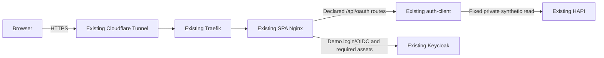

# Design

**Status: DRAFT — proposed decisions for review; no implementation or deployment approval.**

## Context

See [proposal.md](proposal.md) for motivation and
[change 001 verification](../001-oidc-pkce/verification-report.md) for the preserved baseline.
Read-only inspection on 2026-11-13 found:

| Area          | Observed boundary / required extension                                                                                                                                                                    |
| ------------- | --------------------------------------------------------------------------------------------------------------------------------------------------------------------------------------------------------- |
| SPA           | `app/runtime.ts` and `vite.config.ts` enable execution only in private Vite serving mode; production builds compile it off.                                                                               |
| Nginx/hosting | `apps/playground/nginx.conf` is static-only. The external watched `infra/traefik/dynamic/epa-lab.yml` sends the existing hostname to that Nginx.                                                          |
| BFF           | Existing routes, schemas, bounded sessions and token validation work; `configuration.validation.ts` still assigns the legacy issuer to the standard profile.                                              |
| Keycloak      | Existing 26.8.0 instance uses `start-dev`, `KC_DB=dev-file`, private hostname `http://192.168.178.131:5555`; host port 5555 currently binds all interfaces.                                               |
| HAPI          | Reviewed canonical commit is `e65bafc279f02f44b19b47ca7326015886047a63`. Host-only recreation omitted the private overlay's memory/heap/seed settings; data/authentication checks remain implemented.     |
| Edge          | Traefik v3.0 and cloudflared share `dev-proxy`; public port 80 is published. Remote Tunnel ingress/cache/log policy is not established by local configuration. Privileged UFW inspection remains pending. |

## Goals / Non-Goals

**Goals:** one reviewed public binding of the existing mission, independent provider/resource
trust, legacy compatibility, and a host lifecycle that reproduces the accepted settings.
Owner-confirmed access is individual provisioned demo accounts with no public registration.

**Non-Goals:** another BFF/Resource Server/Keycloak instance, public Vite, distributed sessions,
SSO-wide logout, public ePA execution, self-service accounts, clinical data or a visual redesign.
One BFF replica retains the accepted process-local lifetimes and restart semantics.

## Decisions

### 1. One public origin through the existing Nginx

Keep `https://auth-playground.yappai.de`; no additional public hostname is needed.

Add an explicit production OAuth build/target using the existing compiler and final Nginx
runtime. Default builds stay fixture-only; query strings cannot enable execution. Keep the
existing mission-owned API adapter and neutral renderer. The public candidate uses the
existing Workspace, top-level login navigation and exact callback
`https://auth-playground.yappai.de/api/oauth/callback`.

Nginx forwards the six declared API operations, with exact methods and owned-run path shape,
to the current private BFF. It joins the existing private backend network as well as
`dev-proxy`; preserve the BFF's host networking/private port-3000 ePA contracts. Unknown API
routes and legacy `/login`, `/callback`, `/session`, `/epa`, `/fhir`, `/admin`, other realms and
management paths are explicit denials, not SPA fallbacks. Only normal application navigation
receives `index.html`. Alternatives: public Vite and a new gateway service add unjustified
runtime dependencies; a second API hostname introduces unnecessary CORS/cookie boundaries.

Select the backend network as Nginx's egress gateway so host BFF traffic uses the existing
approved bridge/source-subnet firewall path; verify the actual source address after start.

### 2. Isolate the public issuer inside the existing provider

Propose realm `playground-public`, with frontend URL `https://auth-playground.yappai.de` and
issuer `https://auth-playground.yappai.de/realms/playground-public`. Reuse confidential client
ID `playground-oidc` in that realm with a new server-held secret, exact callback, S256,
Code-only/no PAR, RS256 tokens, audience `playground-fhir` and optional permission `demo.fhir.read`.
The definition contains no legacy client, seeded shared user or inherited administrative
roles. Reuse existing managed-client tooling with explicit realm ownership and idempotent
conflict detection; never import the whole `epa-demo` fixture into the public realm.

Keep the global private hostname and existing `epa-demo` configuration/credentials unchanged.
Keycloak documents realm-level frontend URL configuration; proving the pinned version's
dual-realm discovery, token issuer and login behavior is a blocking compatibility test,
not a capability claimed verified here. [Hostname configuration](https://www.keycloak.org/server/hostname)

Public provider routes allow only this realm's discovery, authorization, token, keys,
necessary login-actions and login/common assets. Exclude account/admin consoles, administrative
assets, `master`, `epa-demo`, dynamic client registration and unused protocol interfaces.
Derive the final narrow asset/action allowlist from the real login and required-password-change
tests. Keycloak recommends restricting administrative and management paths at the proxy.
[Reverse-proxy guidance](https://www.keycloak.org/server/reverseproxy)

Alternative: moving `epa-demo` to a public issuer would change its token/callback contract.
This design avoids that migration. If realm-level separation cannot preserve ePA, stop for
an independently verified, separately reviewed compatibility revision; do not change the
global issuer or start a second provider silently.

### 3. Production provider storage is a prerequisite

**Owner-selected arrangement, 2026-11-13:** a dedicated Keycloak PostgreSQL container and
named volume, separate from HAPI's PostgreSQL. Use a distinct database role and no published
port; PostgreSQL 16 remains the proposed supported engine version. This isolates provider
backup/recovery and resource consumption from FHIR storage and is the only additional
supporting service in the plan. Reusing HAPI's PostgreSQL with another database/role was
considered and not selected. The owner's answer confirms this planning decision only;
implementation, migration maintenance and public deployment remain unapproved.

Use the existing pinned Keycloak image in production `start` mode, with explicit hostname,
proxy handling, health and supported database configuration. Preserve the old embedded-data
volume intact. No public ingress while `start-dev`/embedded development storage remains.
Narrow the existing port-5555 binding to its current private LAN address, preserving the
literal ePA issuer and private administration; publish no management or database port.
PostgreSQL is supported by the provider. [Production guide](https://www.keycloak.org/server/configuration-production),
[database guide](https://www.keycloak.org/server/db)

Rehearse migration from a consistent, protected copy: offline all-realm/user export into
an empty target database, without overwriting the live realm. Compare IDs, users/credential
fingerprints, client secrets, keys, roles and ePA policies; prove actual legacy login/PAR.
Exports omit sessions and other state and require stopped nodes for consistency. Therefore
include a maintenance/write-freeze window, fresh-login boundary and old code/refresh/session
rejection tests; do not promise uninterrupted SSO or treat a realm export as a complete
database backup. Failure to preserve required security state blocks cutover.
[Import/export limitations](https://www.keycloak.org/server/importExport)

### 4. Preserve profile binding and constrain demo access

Add a validated standard-profile issuer setting, proposed `PLAYGROUND_OIDC_ISSUER`, defaulting
to `OIDC_ISSUER` for existing private configurations. An explicit public deployment setting
requires the public HTTPS issuer/origin/callback and trusted proxy configuration. Preserve
`epa-par`, all legacy `OIDC_*` meanings, transaction capture and issuer-keyed caches. Do not
add caller-selected profiles or another OAuth framework.

Owner-provisioned users have fictional aliases, unique privately delivered passwords and no
admin roles. Disable registration, federation/social login, unused public-realm clients,
password/service-account grants and public account management. Support Keycloak's initial required password change and
owner-managed reset/deactivation. Set public token lifetime to at most five minutes;
existing BFF authentication expires with token validity. Deactivation stops new login;
issued bearer validity is bounded by expiry, not immediate revocation. Run history remains
bounded to the original fifteen minutes and grants no resource authority.

### 5. Trust the ingress chain explicitly and bound abuse

Apply a project-router `ipAllowList` using the **actual connector socket address**, without
an attacker-controlled forwarded-IP strategy. The hostname's Tunnel origin should use
`http://shared-traefik:80` on `dev-proxy`, preserving connector socket identity rather than
requiring trust in a shared NAT/bridge gateway. Accept Nginx ingress only from the exact
Traefik peer. At that boundary, use Cloudflare's client address only after the connector
and direct-origin restrictions are verified. Overwrite Host/proto/port and forwarded client
identity for the public upstreams; strip conflicting Forwarded, prefix, tracing and diagnostic
headers. The BFF and Keycloak trust only their exact Nginx peer addresses; never use universal
proxy trust or trust all containers on `dev-proxy`. Render/verify these finite peer addresses
on recreation and fail closed on mismatch. No shared global insecure proxy setting is needed.
[Traefik 3.0 peer allowlist](https://doc.traefik.io/traefik/v3.0/middlewares/http/ipallowlist/),
[Cloudflare headers](https://developers.cloudflare.com/fundamentals/reference/http-headers/),
[Nginx trusted address handling](https://nginx.org/en/docs/http/ngx_http_realip_module.html)

Enforce edge HTTPS/HTTP redirect for this hostname and public BFF HTTPS/host checks without
changing private ePA HTTP behavior. Keep host-only Secure/HttpOnly/SameSite=Lax cookies,
fixed paths and exact Origin/context CSRF. Apply SPA-compatible CSP, no-referrer, nosniff and
host-scoped HSTS; retain Keycloak's own page CSP rather than imposing the SPA policy on login.
API/provider-auth/session responses bypass all shared caches; no permissive CORS.

Use built-in Nginx shared-memory limits: proposed per-IP login 6/minute burst 2, resource
30/minute burst 5, read APIs 120/minute burst 20, plus a non-logout aggregate budget of
20 requests/second and finite in-flight/time/body limits. Provider login-actions receive a
separate budget and temporary brute-force lockout. Logout has its own 60/minute burst-10
per-IP budget and separate aggregate 5/second budget; login/read traffic cannot consume
either cleanup budget. Tune only with recorded tests. Return bounded 429/retry guidance;
the adapter localizes API failures without inventing protocol events. Top-level login
throttling also needs a localized safe recovery response linking to the fixed Workspace,
rather than stranding the browser on raw JSON. No Redis, WAF plugin or generic
limiter service is needed. [Nginx request limits](https://nginx.org/en/docs/http/ngx_http_limit_req_module.html)

### 6. Make HAPI and operations reproducible

Decouple HAPI's configured issuer from legacy `OIDC_ISSUER`; trust only the public demo issuer
and its same-origin HTTPS JWKS. Keep the unchanged decoder, `demo.fhir.read`, exact Basic read
and health chains. Preserve host-network BFF access using loopback-only port 8083; expose no
FHIR/management route through Nginx, Traefik or Tunnel. Verify real JWKS retrieval from HAPI,
not only from the host; never substitute private HTTP keys or bypass TLS to fix connectivity.
Set HAPI's public trust to HTTPS-only independently of the legacy ePA private-HTTP setting.

Move the required 4 GiB limit, `-Xms128m -Xmx2g` and explicit guarded synthetic initialization
into the canonical host lifecycle used by Yoster. Keep the existing PostgreSQL volume and
conflict-safe initializer; document deliberate seeding and prove unchanged resource version
on repeat startup. A normal host/Yoster recreation must retain these settings without an
optional overlay. Freeze reviewed image digests; never use an upstream HAPI replacement.

Keep schema-1 evidence and observer/reporter semantics unchanged. Log only operation class,
status, duration and generated correlation ID; omit URLs/query, cookies, bodies and identity.
Suppress credential-route error diagnostics that would include raw request lines; a safe
access/status record must remain. Verify actual rate-limit, upstream-error and callback
failures across Nginx, BFF, provider, resource server and controlled edge logs. Traefik access
logging is presently unconfigured; do not enable shared raw logs/debug for this rollout.
Confirm Cloudflare query capture/redaction/retention before publication; missing assurance
is a blocker, not a clean disclosure result.

Reuse Yoster private health checks and the existing host/CI scheduler for public availability
and a dedicated non-admin synthetic browser smoke test. Define failure/429/capacity thresholds,
response owner and existing alert destination in the release runbook. No new monitoring
service is proposed. Preserve DE/EN copy, artwork, layout, focus and literal evidence;
update only public demo availability, rate-limit/recovery wording and existing mission actions.

## Risks / Trade-offs

| Risk                                              | Mitigation                                                                                                                                                                            |
| ------------------------------------------------- | ------------------------------------------------------------------------------------------------------------------------------------------------------------------------------------- |
| Provider production migration affects ePA         | Isolated rehearsal, exact issuer/key/user/policy comparisons, real ePA tests, consistent backup, bounded maintenance and tested recovery before ingress.                              |
| Shared edge trust or logs leak credentials        | Project-only peer restrictions, overwritten headers, negative spoof/bypass tests and actual secret-sentinel failure-path scans; no global proxy loosening.                            |
| Public abuse exhausts local stores                | Verified-IP and aggregate/in-flight limits, short tokens, owner-controlled accounts, unchanged storage bounds and independent cleanup. One BFF replica; restart requires fresh login. |
| Host-only recreation drops HAPI settings          | Canonical host/Yoster manifest and ordinary lifecycle acceptance, immutable image/source records and preflight drift detection.                                                       |
| External HTTPS authority is unavailable from HAPI | Test fresh JWKS acquisition and deny unknown/invalid credentials; block release on transport failure rather than weakening trust.                                                     |
| Additional provider database consumes resources   | Confirm measured host capacity and finite database/provider limits before migration; stop if capacity is inadequate. No existing database reset or unrelated service shutdown.        |

## Migration Plan

1. After explicit approval of this change, align active authorization/architecture/UX/hosting
   documentation without rewriting change 001's accepted private history. Record the exact
   scope and verify it uses the owner-selected dedicated provider database. Settle the operational values below and independently close
   the privileged UFW order/duplicate/default-policy/backup-integrity finding.
2. Build and stage versioned artifacts; rehearse provider migration, public realm/proxy
   compatibility, complete security/UX matrix and rollback using copies and synthetic users.
   Validate fresh recursive checkout, production package/Java/image advisories and unchanged
   ePA/PAR regressions. Unrelated development findings remain separately recorded.
3. Produce the concrete release packet: commits/image digests, merged Compose/Yoster and
   host-scoped proxy/Tunnel diffs, exact peer addresses, finite limits, monitoring thresholds,
   protected mode-0700/0600 backups and tested commands. Save the **current available fixture
   image**; the older historical fixture image may have been pruned. Publication requires
   explicit owner authorization; planning/CLI readiness alone grants none.
4. In the authorized maintenance window freeze provider writes, snapshot/export consistently,
   migrate into the new provider database and verify private ePA before any public ingress.
   Keep old data/configuration intact. Recreate only the reviewed project services, never
   use a shared `compose down`, and preserve the FHIR database and unrelated projects.
5. Rebind only the standard profile to the public realm/origin and HAPI trust to that issuer.
   Withdraw the obsolete private Vite execution entry on 5173; one BFF cannot simultaneously
   advertise the old and new standard callback binding. Enable the production candidate
   through the existing host route and perform real public acceptance before availability
   promotion. No direct auth-client, HAPI, database or management publication is added.
6. Verify actual public login/303/reload/read/Inspector/CSRF logout/history, spoof/cache/bypass
   negatives, external port isolation, two-browser ownership, restart recovery, ordinary
   Yoster recreation and ePA regressions. Start existing-tool monitoring and retain a
   requirement-to-test result map; no mock or isolated-origin success substitutes for this.

**Targeted rollback:** withdraw OAuth/provider ingress first and restore the saved fixture
Nginx release/router policy. Disable public standard execution and clear its credentials/
contexts; retain patched images and valid private trust, then restore the recorded private
binding only if its prerequisites pass. Keep a successfully migrated provider on PostgreSQL
to retain subsequent user changes; disable the new demo realm rather than deleting shared
data. If provider migration itself fails before the maintenance write freeze is lifted,
restore the preserved old provider configuration/data with public ingress closed and retain
the failed target database for diagnosis. Never revert a live, writable provider to a stale
H2 snapshot. Exercise both failure stages in rehearsal and verify fixture-only public behavior,
private ePA and retained data afterward.

## Open Questions

These are deployment values, not deferred architecture choices; record them before rollout:

- Confirm the remote Cloudflare hostname mapping/connector, canonical origin handling,
  TLS/cache rules and controlled logging capabilities. Local inspection suggests the
  `yappai-cloudflared` connector but does not establish the remote configuration.
- Record exact trusted peer addresses and their recreation/update procedure, privileged
  firewall evidence and external direct-origin reachability results.
- Choose the maintenance time, response owner, existing scheduler/alert destination and
  measured provider/database resource budgets. If these cannot meet the stated contract,
  block deployment rather than claiming verification.
